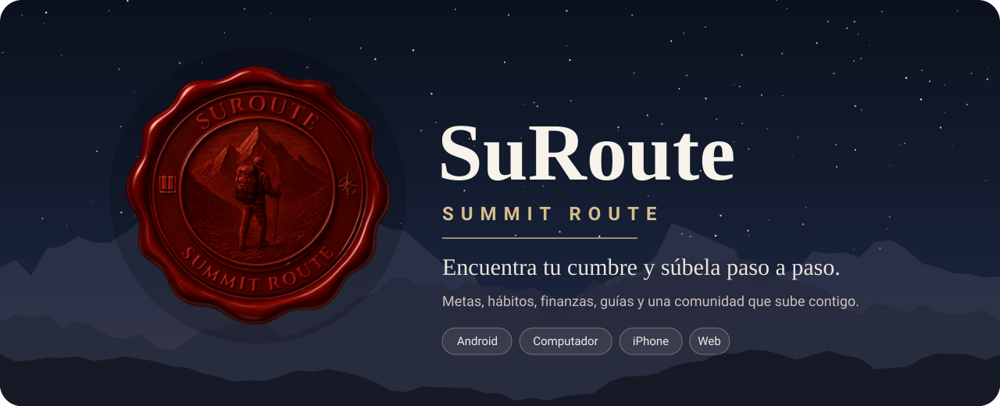
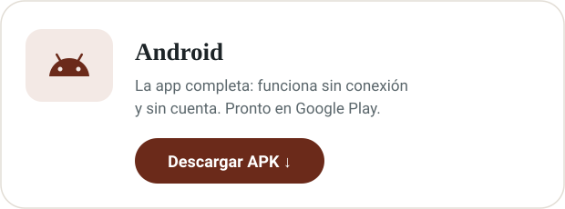
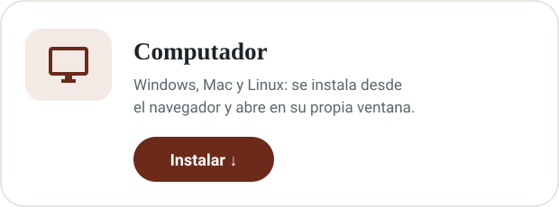
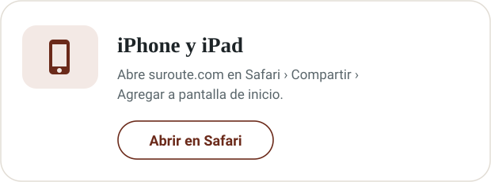
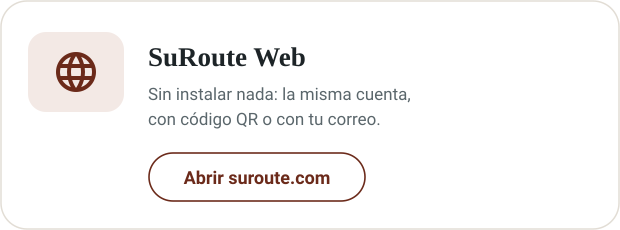
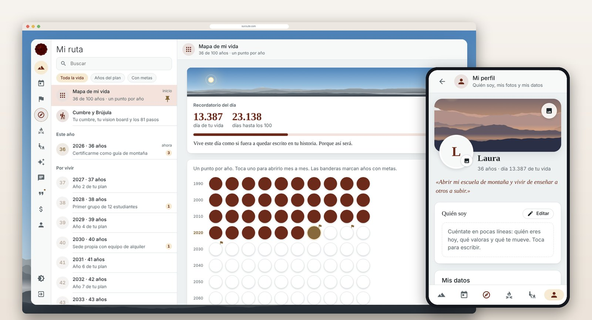
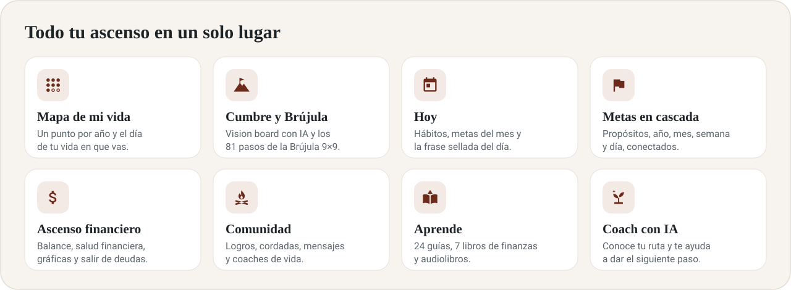
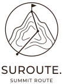
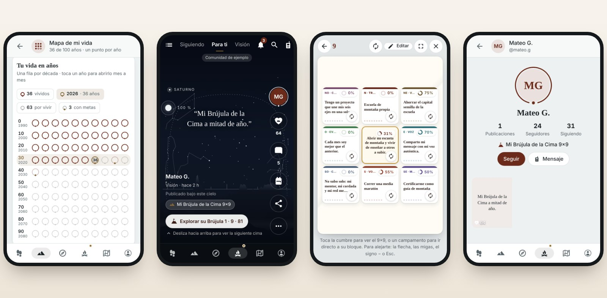
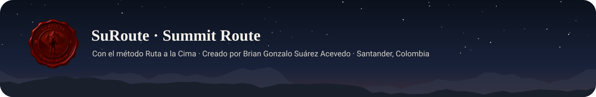

  

  
  
  
  
  

## Descargar

Elige dónde quieres subir. Es la misma cuenta en todas partes y, sin cuenta, la app funciona completa en el teléfono.

<table>
  <tr>
    <td width="50%"></td>
    <td width="50%"></td>
  </tr>
  <tr>
    <td width="50%"></td>
    <td width="50%"></td>
  </tr>
</table>

En Android, si el teléfono lo pide, permite «Instalar apps desconocidas» para el navegador. Todas las opciones están también en <a href="https://suroute.com/descargar.html">suroute.com/descargar</a>.

## Qué es SuRoute

SuRoute convierte el método **Ruta a la Cima** en una app para cada día. Tu vida es la montaña, cada día es un paso
y la cumbre es tu propósito.

Ves tu vida como un mapa, **un símbolo de SuRoute por año**, y la bajas en cascada: propósito, año, mes, semana y día. Lo que
marcas hoy sube solo hasta tu propósito. Así siempre sabes cuál es tu siguiente paso y cuánto has subido.

  

## Lo que hace

  

- **Mapa de mi vida.** Un símbolo por año hasta los 100 o 120: los vividos en tinta, este año en oro y los años
  con metas con su punto del sur encendido.
- **Cumbre y Brújula.** Tu cumbre en una frase, el vision board que arma la IA con tus fotos y la Brújula 9×9:
  la cumbre, 8 campamentos y 64 pasos. Una Brújula general para toda la vida y una para cada año.
- **Hoy.** 18 hábitos (tres por cada eje), las metas del mes y una frase de los libros sellada con cera.
- **Ascenso financiero.** Balance, salud financiera, gráficas, activos y pasivos, y un plan para salir de deudas.
- **Comunidad.** Cimas a pantalla completa con fotos, carrusel y video; *Para ti*, *Siguiendo* y *Visión*;
  avisos, búsqueda de personas, perfiles públicos, @menciones, #etiquetas, retos del mes, coaches verificados,
  cordadas y mensajes. Tu muro tiene final.
- **Seguridad en la comunidad.** Silenciar, bloquear y reportar; elegir quién te comenta, ocultar comentarios,
  protección para menores de 14 a 17 años y apelaciones con respuesta a quien reporta.
- **Aprende.** 24 guías del método, 7 libros de finanzas y audiolibros.
- **Coach con IA.** Conoce tus metas y tu avance, y te ayuda a dar el siguiente paso.
- **Tu perfil.** Portada, foto con el anillo del símbolo, «Quién soy» y un editor de fotos para recortar,
  girar y aplicar filtros.

## Nuestro símbolo

<picture><source media="(prefers-color-scheme: dark)" srcset="diseno/logo/suroute-logo-vertical-crema.svg"></picture>

Un círculo abierto al sur y un punto en el hueco: **el sur en el interior**. Es el punto de partida, la base y un
camino que empieza desde adentro hacia afuera. Es simple, se lee igual en un cartel que en el ícono más pequeño,
y en SuRoute aparece con discreción: en el ícono de la app, en cada año del mapa de tu vida, alrededor de tu foto
de perfil y girando despacio mientras algo carga. La explicación completa está en
[suroute.com/conoce](https://suroute.com/conoce.html#simbolo).

## Capturas

  

## Privacidad

- **Primero en tu teléfono.** Sin cuenta, todo se queda en el teléfono y la app funciona completa.
- **La cuenta es opcional.** Solo hace falta para la comunidad, el coach con IA y la web.
- **Nadie ve tu ruta.** Cada tabla del servidor tiene reglas de seguridad por persona, y tú eliges si cada
  publicación es pública, para tus seguidores o solo para ti.
- **Sin publicidad.** No vendemos tus datos ni mostramos anuncios.
- **El rostro y la huella** los verifica el teléfono; la app nunca los ve.
- **Puedes irte con todo:** copia de seguridad, exportar y *Eliminar mi cuenta* siempre a la vista.
- **Lo esencial nunca se cobra:** el método, la comunidad, la web y tus datos.

SuRoute cumple la Ley 1581 de 2012 de Colombia. Los documentos están en el
[centro legal](https://suroute.com/legal.html):
[privacidad](https://suroute.com/privacidad.html) ·
[términos](https://suroute.com/terminos.html) ·
[normas de la comunidad](https://suroute.com/normas.html).

## Más información

| | |
|---|---|
| [**Guía de SuRoute**](docs/GUIA.md) | El método en la app y el recorrido completo: cada pantalla, la web, el Plan Cumbre, la privacidad y la moderación. |
| [**Para desarrolladores**](docs/DESARROLLO.md) | Instalar y ejecutar, servidor (Supabase), coach IA, cómo está hecha y las pruebas. |
| [**Google Play**](docs/google-play.md) | Seguridad de los datos, contenido de la app y textos de la ficha. |
| [**Conoce SuRoute**](https://suroute.com/conoce.html) | La página de presentación: funciones, privacidad, lo que nos hace distintos y el símbolo. |
| [**Diseño**](diseno) | El símbolo, los íconos y los archivos en alta resolución. |

  

Serie Ruta a la Cima · © 2026 Brian Gonzalo Suárez Acevedo

